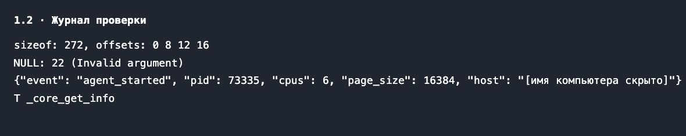

# 1.2 C и Python вместе

Собрать ядро на C в динамическую библиотеку и вызвать его из Python через ctypes.

[Открыть отчёт в PDF](report.pdf) · [Скриншот проверки](screenshots/01-verification.png)

Собрала ядро из 1.1 в динамическую библиотеку. Подключила её через `ctypes`, проверила раскладку структуры и ошибку пустого указателя. Python формирует событие `agent_started` в JSON.

Запуск из папки `agent/` на macOS:

```sh
clang -Wall -Wextra -Werror -dynamiclib core/core_info.c -o core/libsentry_core.dylib
python3 brain/brain.py --layout
python3 brain/brain.py --check-null
python3 brain/brain.py
```

[Результат проверки](verification.txt) · [Глава курса](https://maximbytecamp.github.io/sysprog_makarov/temy/07-c-i-python-vmeste/index.html)


