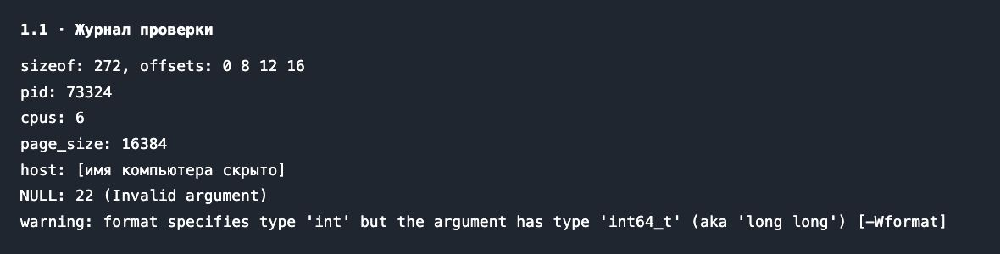

# 1.1 C для системного программиста

Написать функцию на C, которая получает сведения о системе и возвращает их в структуре фиксированного размера.

[Открыть отчёт в PDF](report.pdf) · [Скриншот проверки](screenshots/01-verification.png)

Реализовала ядро, которое возвращает PID, число логических процессоров, размер страницы памяти и имя компьютера. Проверила размер структуры, смещения полей и обработку пустого указателя.

Сборка и запуск из папки `1.1` на macOS:

```sh
clang -Wall -Wextra -Werror -o show_info show_info.c core_info.c
./show_info
./show_info --check-null
```

[Результат проверки](verification.txt) · [Глава курса](https://maximbytecamp.github.io/sysprog_makarov/temy/06-c-dlya-sistemnogo-programmista/index.html)


