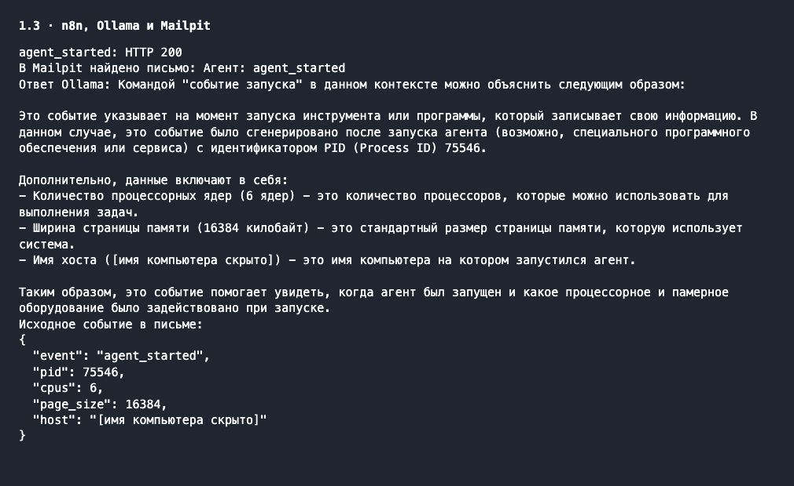

# 1.3 n8n и Ollama

Передать событие agent_started в вебхук, получить пояснение от локальной модели и подготовить тестовое письмо.

[Открыть отчёт в PDF](report.pdf) · [Скриншот проверки](screenshots/01-verification.png)

Подготовила отправку события `agent_started` и сценарий для импорта в n8n. В сценарии вебхук передаёт данные в цепочку с Ollama, а её ответ используется в тестовом письме.

Для запуска в n8n импортируйте [agent-started.json](agent-started.json), подключите локальную Ollama и тестовый SMTP (например, Mailpit). Запустите прослушивание тестового вебхука и выполните из папки `agent/`:

```sh
python3 -B n8n/send_event.py http://localhost:5678/webhook-test/agent --library core/libsentry_core.dylib
```

Проверила всю цепочку локально. n8n принял POST и вернул HTTP 200. Модель `qwen2.5:3b` сформировала объяснение, а Mailpit получил письмо с пояснением и исходным JSON. В пояснении модель ошиблась в единицах — `page_size: 16384` означает 16 384 байта, или 16 КиБ.

[Результат проверки](verification.txt) · [Глава курса](https://maximbytecamp.github.io/sysprog_makarov/temy/08-n8n-i-ollama/index.html)


