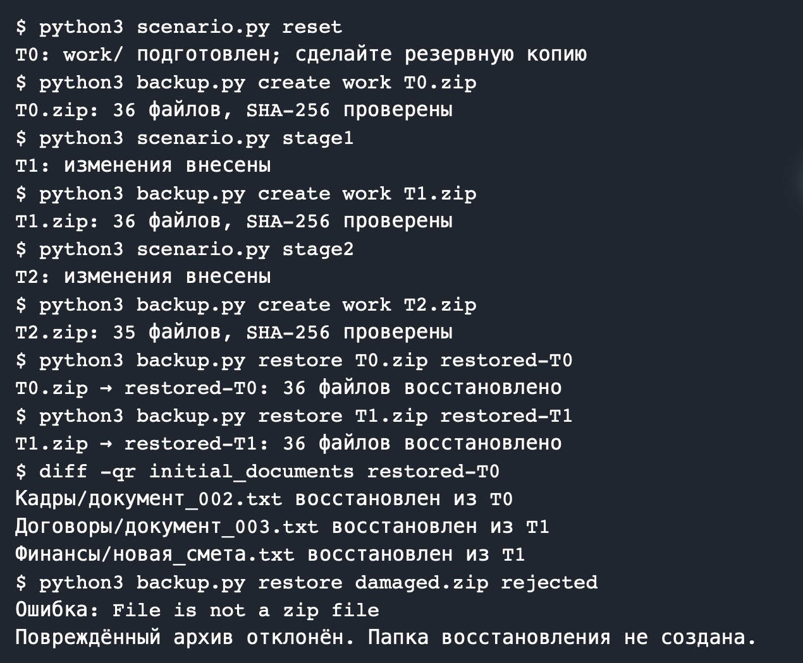

# Домашнее задание. Кейс 03 «Резервное копирование»

## Задание

Создать три резервные копии учебной папки на этапах T0, T1 и T2. Проверить целостность каждой копии и предусмотреть защиту от сохранения неполного архива. Восстановить T0 и T1 в отдельные папки и убедиться, что удалённые документы вернулись.

## Что сделала

Написала программу на Python. Она записывает архив во временный файл, проверяет состав архива и SHA-256 каждого документа, затем сохраняет готовую копию. При восстановлении программа сначала проверяет архив и контрольные суммы извлечённых файлов.

| Версия | Когда создана | Файлов | Архив |
| --- | --- | ---: | --- |
| T0 | Исходное состояние | 36 | [T0.zip](archives/T0.zip) |
| T1 | После первого изменения | 36 | [T1.zip](archives/T1.zip) |
| T2 | После второго изменения | 35 | [T2.zip](archives/T2.zip) |

Восстановила T0 и T1. Сравнила T0 с исходной папкой и подтвердила, что после восстановления появились кадровый документ, договор и смета, которые были удалены на следующих этапах. Также проверила, что программа отклоняет намеренно укороченный архив. Папка восстановления при ошибке не создаётся.

## Файлы

[Отчёт в PDF](report.pdf) · [Программа](backup.py) · [Сценарий проверки](demo.sh) · [Журнал проверки](verification.txt)

ИИ: использовала для подготовки решения, проверки и оформления отчёта.
