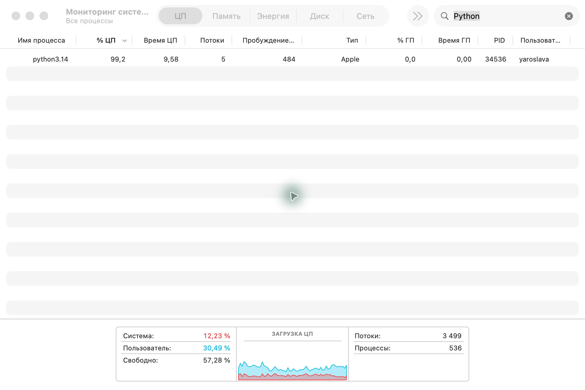
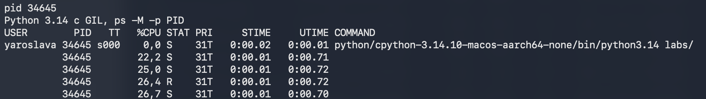
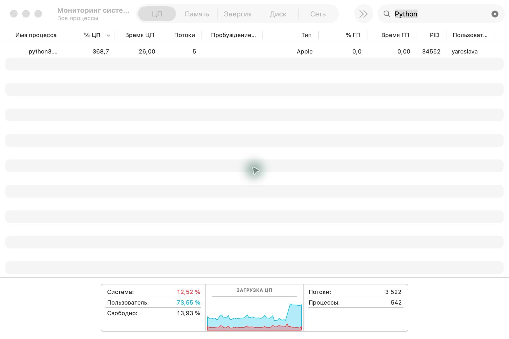

# Лабораторная 7

Система: macOS. Логических процессоров: 6. Python: 3.14.10 с GIL и без него.

## Python с GIL

Процесс использовал 99,2% одного ядра. Всего пять потоков: один главный и четыре рабочих. GIL позволяет выполнять код Python только одному рабочему потоку за раз. Главный поток ждёт завершения рабочих.

На снимке Терминала один рабочий поток в состоянии R, три рабочих и главный в состоянии S.

## Python без GIL

Процесс использовал 368,7% ЦП. В выводе `ps -M` все четыре рабочих потока были в состоянии R. Загрузка потоков в этом замере: 84,4%, 88,1%, 84,3% и 87,7%.

## Время работы

| Режим | 1 поток | 2 потока | 4 потока |
|---|---:|---:|---:|
| Python с GIL | 1,163 с | 1,178 с | 1,210 с |
| Python без GIL | 1,323 с | 0,854 с | 1,266 с |
| Сборка 3.14t с `PYTHON_GIL=1` | 1,657 с | 1,585 с | 1,602 с |

Без GIL четыре потока выполнили ту же работу примерно в 1,05 раза быстрее одного (1,323 / 1,266). Два потока без GIL показали лучшее время: 0,854 с.

Ожидание: 2,003 с для одного потока и 2,009 с для четырёх. Во время `sleep` поток освобождает GIL, поэтому четыре потока могут ждать одновременно.

[Открыть отчёт в PDF](report.pdf)

ИИ: использовала для подготовки отчёта, пояснения результатов и проверки оформления.

[Отчёт в PDF](report.pdf)
