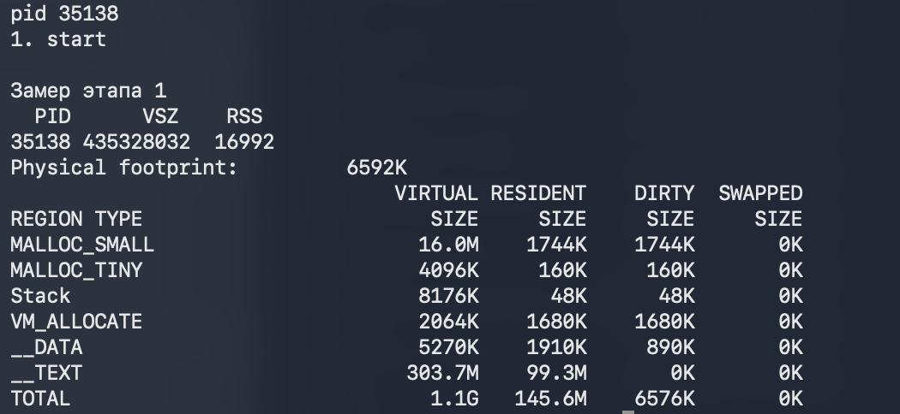
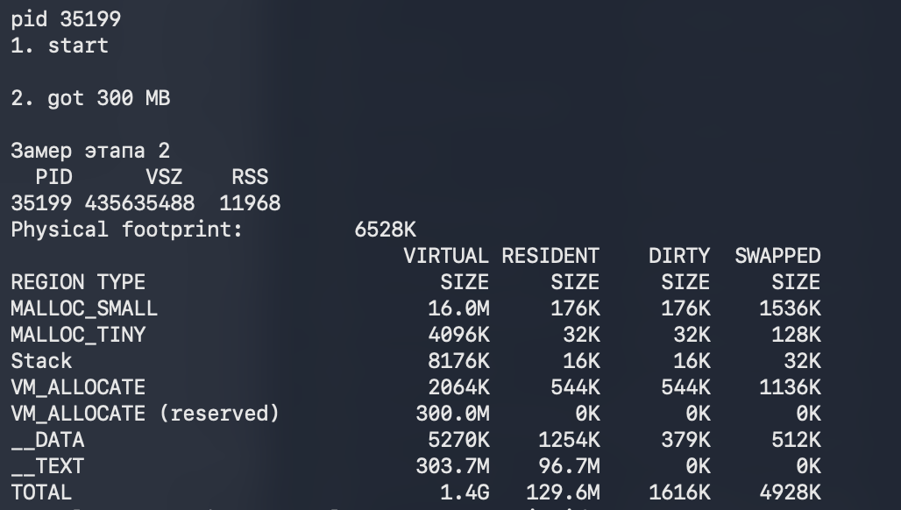
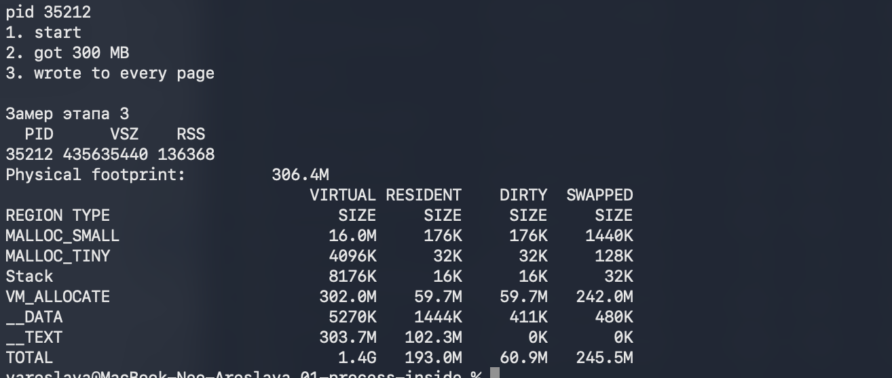
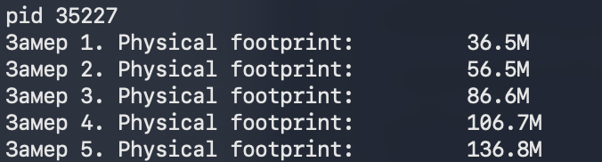

# ЛР 8. Карта памяти

Система: macOS, Apple Silicon. Виртуальную память измерял по VSZ, резидентную по RSS в `ps`, физический след по Physical footprint в `vmmap -summary`.

## Этапы mem.py

| Этап | VSZ, КБ | RSS, КБ | Физический след |
|---|---:|---:|---:|
| Старт | 435 328 032 | 16 992 | 6 592 КБ |
| Получено 300 МБ | 435 635 488 | 11 968 | 6 528 КБ |
| Запись в каждую страницу | 435 635 440 | 136 368 | 306,4 МБ |
| Освобождение | 435 328 496 | 12 096 | 6 464 КБ |

При выделении 300 МБ в карте появился резерв с нулевым резидентным размером. После записи в каждую страницу физический след вырос примерно на 300 МБ. Часть страниц была сжата, поэтому RSS вырос меньше. После освобождения VSZ и физический след вернулись примерно к исходному уровню. Освобождение измерено в отдельном запуске.

## Карта памяти

В карте есть код (`__TEXT`), данные (`__DATA`), стек, куча (`MALLOC_SMALL`, `MALLOC_TINY`) и области `VM_ALLOCATE`. На старте в строке TOTAL было 1,1 ГБ виртуальной и 145,6 МБ резидентной памяти. TOTAL в карте и VSZ в `ps` учитывают виртуальные области по-разному.

## Утечка

Пять замеров физического следа: 36,5 → 56,5 → 86,6 → 106,7 → 136,8 МБ. За один интервал след увеличивался примерно на 20–30 МБ. Программа сохраняла выделенные блоки в списке, поэтому память продолжала расти.

## Снимки экрана

[Открыть отчёт в PDF](report.pdf)

ИИ: использовала для подготовки отчёта, пояснения результатов и проверки оформления.

[Отчёт в PDF](report.pdf)
