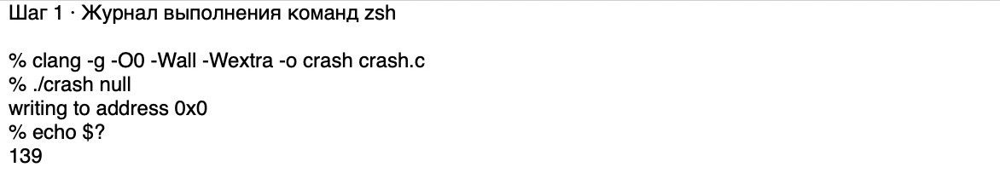
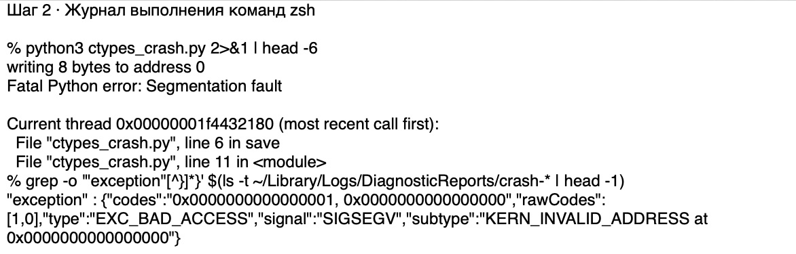
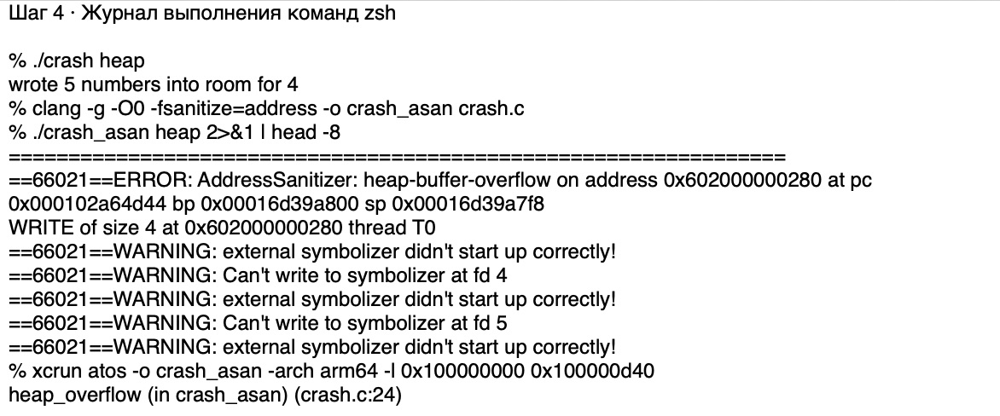
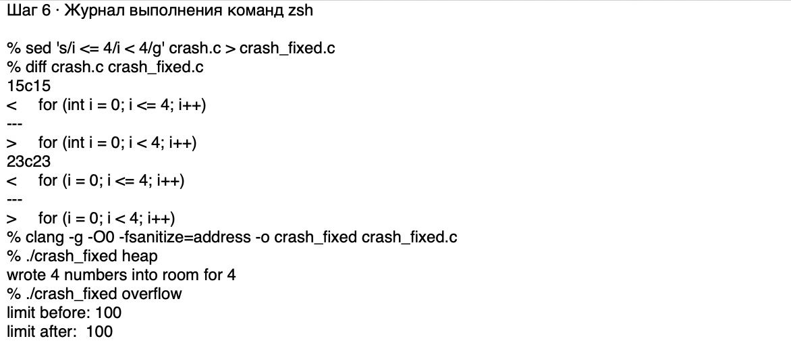

# ЛР 9. Разбор падения

Разобрала системный отчёт о падении и диагностику AddressSanitizer. При записи по нулевому адресу получен SIGSEGV (код завершения 139). В отчёте Python указан вызов функции save. Диагностика AddressSanitizer указывает на выход за границу выделенной памяти и обращение к освобождённой памяти. В исправленной версии проверка границ сохраняет значение limit равным 100.

## Снимки экрана

ИИ: использовала для подготовки отчёта, пояснения результатов и проверки оформления.

[Отчёт в PDF](report.pdf)
